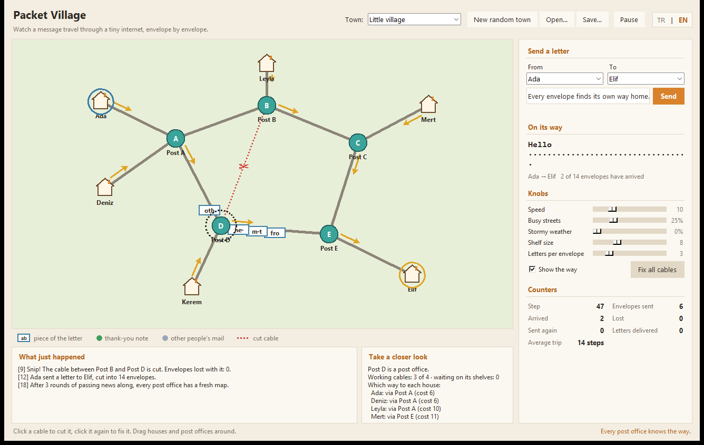

# Packet Village

Türkçe: [README.tr.md](README.tr.md)

Packet Village is a tiny town where you watch a message get cut into envelopes, find its own way from house to house, and get glued back together at the other end, the way the internet really moves your messages.



## Start it

You only need Python 3.9 or newer. There is nothing else to install.

```
python3 -m packet_village
```

A window opens with a village that is already busy: Ada is sending Elif a letter, and you can see the envelopes moving. Now try these:

- **Click a cable** to cut it. Envelopes on it are lost, the post offices notice, and within a few moments the letters take another road. Click it again to fix it.
- **Drag** houses and post offices around.
- **Write your own letter** on the right, pick who sends it and who receives it, press *Send*.
- **Turn the knobs**: make the streets busier, add stormy weather, shrink the shelves in the post offices, and watch what goes wrong and how the town copes.
- **Click a house or a post office** to see which way it would send mail to every house.

The **TR | EN** switch in the top right corner changes every text in the window at once; the choice is remembered. Without a saved choice the language follows your system.

On some Linux systems Tkinter comes as a separate package (`python3-tk` on Debian and Ubuntu). If the window cannot open, the program says so and the terminal mode below still works.

## What you are looking at

| On screen | What it stands for |
| --- | --- |
| House | A computer that sends and receives messages |
| Post office (teal circle) | A router; it turns red as its shelves fill up |
| Cable | A network link. Thick cables take one envelope at a time; thin ones are narrow and slow to enter |
| White envelope with letters | One packet of your message, carrying a few characters |
| Pale yellow envelope | A packet that is being sent again |
| Green dot | An acknowledgement ("thank-you note") going back to the sender |
| Grey dots | Other people's mail, the background traffic |
| Orange arrows | Where every node would send mail for the chosen receiver right now |
| Red ring | An envelope was lost here |

The counters on the right show how many envelopes were sent, arrived, got lost or were sent again. The panel under the map tells the story of the current letter in plain sentences.

## The towns

| Town | What it shows |
| --- | --- |
| Little village | The default: several routes, easy to reroute around a cut |
| Two hills | A narrow bridge (a bottleneck) next to a wide but long detour. Turn up the traffic and watch the bridge queue fill |
| Round town | Post offices in a ring. Cut one cable and mail goes the whole way round |
| Busy city | A grid with many equally good paths and lots of chatter |
| New random town | Builds a fresh town that is always fully connected |

You can save any town (including the positions you dragged things to and which cables are cut) with *Save…* and open it again later with *Open…*. Town files are plain JSON.

## What happens under the hood

Everything runs on a single clock that ticks forward in whole steps. The window only draws what the simulation says; it never changes the state directly.

**Routing.** Every node runs a distance-vector protocol: it only knows what its direct neighbours told it during the last exchange. Cable delay is the cost. When a cable is cut, the two ends notice immediately, and everybody else learns about it second hand, one round at a time. That is why the arrows take a moment to swing around after a cut. Poisoned reverse (never advertising a route back to the neighbour you learned it from) keeps two nodes from bouncing envelopes between each other. A plain Dijkstra is kept as the ground truth: the tests check that the protocol always settles on the same costs.

**Delivery.** Each letter is a conversation between two houses, modelled closely on TCP Reno:

- a congestion window that starts at two envelopes, doubles every round trip in slow start, and grows slowly after that;
- a retransmission timer that follows the measured round-trip time (Jacobson/Karels smoothing). Thank-you notes echo the send time of the envelope that triggered them, so resent envelopes still give clean measurements;
- fast retransmit after three duplicate acknowledgements, with NewReno-style handling of partial acknowledgements;
- on a timeout the window collapses to one and the sender goes back to the first missing piece;
- the receiver keeps pieces that arrive out of order and always answers "I have everything before piece N".

A sender keeps trying for a long time while its house still knows some way to the receiver, but gives up soon when there is no road at all.

**Post offices.** Every cable direction has a shelf (a first-in, first-out queue) of limited size. A full shelf means new envelopes are thrown away. Envelopes also carry a hop limit so they cannot wander forever while maps are being redrawn, and stormy weather gives every cable crossing a chance to spoil an envelope.

## Terminal mode

The same simulation runs without a window, which is handy for scripts or a quick look:

```
python3 -m packet_village --headless
python3 -m packet_village --headless --scenario ring --cut A-B --message "Around we go"
python3 -m packet_village --headless --from Mert --to Kerem --chatter 0.8 --noise 0.05 --seed 3
python3 -m packet_village --list
```

It prints the planned route, the letter filling in piece by piece, the story and a short summary. The exit code is 0 when the letter arrived, 2 when the sender gave up and 3 when the step limit ran out. Add `--lang tr` or `--lang en` to pick the language; otherwise it comes from `LC_ALL`, `LC_MESSAGES`, `LANG` or `LANGUAGE`, then the system locale, and falls back to English. `--help` lists every option in the chosen language.

## Settings

The window remembers the language, speed, knob positions and the last town in `~/.packet_village.json`. Set the `PACKET_VILLAGE_SETTINGS` environment variable to use another file. A broken or missing file simply means defaults.

## Project layout

```
packet_village/
  topology.py    houses, post offices and cables (plain data + graph helpers)
  routing.py     distance-vector routing and the Dijkstra reference
  packets.py     envelopes, cutting a message into pieces and joining them
  transport.py   reliable delivery for one letter (window, timers, retransmits)
  engine.py      the clock: queues, cables, flows, background chatter, stats
  narrate.py     turns engine events into sentences
  strings.py     every visible sentence, English and Turkish
  i18n.py        language detection and lookup
  scenarios.py   the built-in towns
  generator.py   random towns (spanning tree plus extra cables)
  storage.py     saving and loading towns as JSON
  settings.py    remembered preferences
  geometry.py    small 2D helpers for drawing and hit testing
  cli.py         command line and terminal mode
  ui/            the Tkinter window (app, map view, sidebar, colours)
tests/           unit tests for everything outside ui/
```

The core modules do not import anything from `ui/`, so the simulation can be tested and scripted without a display.

## Tests

```
python3 -m unittest discover -s tests -t .
```

The tests cover routing convergence on every built-in town and on random towns, healing after cuts and partitions, the sender's window, timers and retransmissions (including a lossy fake channel), full deliveries through the engine under congestion, storms and cut cables, file validation, settings, the random town builder, the terminal mode, and that the English and Turkish tables have the same keys and placeholders.

## License

MIT, see [LICENSE](LICENSE).
