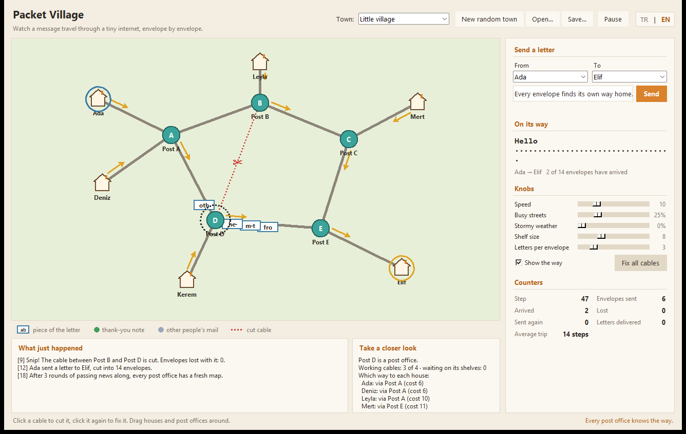

# Paket Köyü

In English: [README.md](README.md)

Paket Köyü, bir mesajın zarflara bölünüp evden eve kendi yolunu bulduğunu ve öbür uçta yeniden birleştirildiğini izleyebileceğin minik bir kasaba; internet de mesajlarını tam olarak böyle taşır.



## Başlatmak için

Python 3.9 ya da daha yenisi yeterli. Başka hiçbir şey kurmana gerek yok.

```
python3 -m packet_village
```

Açılan pencerede köy zaten hareketli: Ada, Elif'e bir mektup yolluyor ve zarfların ilerleyişini görebiliyorsun. Şimdi şunları dene:

- **Bir kabloya tıkla**, kablo kesilsin. Üzerindeki zarflar kaybolur, postaneler durumu fark eder ve birkaç an içinde mektuplar başka bir yoldan gitmeye başlar. Onarmak için yeniden tıkla.
- Evleri ve postaneleri **sürükleyip** yerlerini değiştir.
- Sağ taraftan **kendi mektubunu yaz**, göndereni ve alıcıyı seç, *Gönder*'e bas.
- **Ayarlarla oyna**: sokakları kalabalıklaştır, fırtına çıkar, postanelerin raflarını küçült; neyin ters gittiğini ve kasabanın bununla nasıl başa çıktığını izle.
- **Bir eve ya da postaneye tıkla**, her eve postayı hangi yoldan göndereceğini gör.

Sağ üst köşedeki **TR | EN** düğmesi penceredeki bütün yazıları anında değiştirir ve seçimin hatırlanır. Kayıtlı bir seçim yoksa dil, sisteminin diline göre belirlenir.

Bazı Linux dağıtımlarında Tkinter ayrı bir paket olarak gelir (Debian ve Ubuntu'da `python3-tk`). Pencere açılamazsa program bunu söyler; aşağıdaki terminal modu yine de çalışır.

## Ekranda neler var

| Ekranda | Neyi temsil ediyor |
| --- | --- |
| Ev | Mesaj gönderip alan bir bilgisayar |
| Postane (yeşilimsi daire) | Bir router; rafları doldukça kızarır |
| Kablo | Bir ağ bağlantısı. Kalın kablolar zarfları arka arkaya alır, ince olanlar dardır ve zarfları daha seyrek kabul eder |
| Üstünde harfler olan beyaz zarf | Mesajının birkaç karakter taşıyan bir parçası (paket) |
| Soluk sarı zarf | Yeniden gönderilen bir paket |
| Yeşil nokta | Göndericiye dönen onay, yani "teşekkür notu" |
| Gri noktalar | Başkalarının postası, arka plandaki trafik |
| Turuncu oklar | Seçili alıcıya giden postayı her noktanın şu an nereye yollayacağı |
| Kırmızı halka | Burada bir zarf kayboldu |

Sağdaki sayaçlar kaç zarfın gönderildiğini, ulaştığını, kaybolduğunu ya da yeniden yollandığını gösterir. Haritanın altındaki bölüm ise mektubun başına gelenleri sade cümlelerle anlatır.

## Kasabalar

| Kasaba | Ne gösteriyor |
| --- | --- |
| Küçük köy | Varsayılan kasaba: birden fazla yol var, bir kesiğin etrafından dolaşmak kolay |
| İki tepe | Dar bir köprü (darboğaz) ve yanında geniş ama uzun bir dolambaç. Trafiği artır, köprünün önündeki kuyruğun dolmasını izle |
| Yuvarlak kasaba | Çember şeklinde dizilmiş postaneler. Bir kabloyu kes, posta çemberin öbür yanından dolaşsın |
| Kalabalık şehir | Birbirine eşit pek çok yolu ve bol gürültüsü olan bir ızgara |
| Yeni rastgele kasaba | Her seferinde, her noktası birbirine bağlı yepyeni bir kasaba kurar |

Herhangi bir kasabayı (sürüklediğin yerler ve kestiğin kablolar dahil) *Kaydet…* ile saklayıp daha sonra *Aç…* ile geri yükleyebilirsin. Kasaba dosyaları düz JSON'dur.

## Perde arkasında neler oluyor

Her şey tek bir saatle, tam adımlar halinde ilerler. Pencere yalnızca simülasyonun söylediğini çizer, durumu kendisi hiç değiştirmez.

**Yol bulma (routing).** Her nokta bir distance-vector protokolü çalıştırır: yalnızca komşularının son görüşmede kendisine söylediklerini bilir. Maliyet, kablonun gecikmesidir. Bir kablo kesildiğinde iki ucu bunu hemen fark eder; geri kalan herkes haberi tur tur, kulaktan dolma öğrenir. Kesikten sonra okların dönmesinin biraz zaman alması bundandır. Poisoned reverse (bir yolu, onu kimden öğrendiysen ona geri önermemek) iki noktanın zarfları birbirine atıp durmasını engeller. Doğruluk ölçütü olarak düz bir Dijkstra da var: testler, protokolün her zaman aynı maliyetlere oturduğunu kontrol ediyor.

**Teslimat.** Her mektup iki ev arasındaki bir konuşmadır ve TCP Reno'ya oldukça yakın modellenmiştir:

- iki zarfla başlayan, slow start sırasında her gidiş-dönüşte ikiye katlanan, sonra yavaşça büyüyen bir congestion window;
- ölçülen gidiş-dönüş süresini izleyen bir yeniden gönderme zamanlayıcısı (Jacobson/Karels yumuşatması). Teşekkür notları kendilerini tetikleyen zarfın gönderilme zamanını geri taşıdığı için yeniden yollanan zarflar da temiz ölçüm verir;
- üç kopya onaydan sonra hızlı yeniden gönderme ve kısmi onaylar için NewReno tarzı davranış;
- zaman aşımında pencere bire düşer ve gönderici ilk eksik parçaya geri döner;
- alıcı sırası karışık gelen parçaları saklar ve her zaman "N. parçadan öncekilerin hepsi bende" diye cevap verir.

Gönderici, evi alıcıya giden bir yol bildiği sürece uzun süre denemeye devam eder; hiç yol yoksa çabucak pes eder.

**Postaneler.** Her kablonun her yönü için sınırlı büyüklükte bir raf (ilk giren ilk çıkar kuyruğu) vardır. Raf doluysa yeni gelen zarflar çöpe gider. Zarflar ayrıca bir atlama sınırı taşır; böylece haritalar yeniden çizilirken sonsuza kadar dolaşamazlar. Fırtınalı havada da her kablo geçişinde bir zarfın ıslanıp okunamaz hale gelme ihtimali vardır.

## Terminal modu

Aynı simülasyon pencere açmadan da çalışır; betikler ya da hızlı bir bakış için kullanışlıdır:

```
python3 -m packet_village --headless
python3 -m packet_village --headless --scenario ring --cut A-B --message "Tur atıyoruz"
python3 -m packet_village --headless --from Mert --to Kerem --chatter 0.8 --noise 0.05 --seed 3
python3 -m packet_village --list
```

Planlanan yolu, parça parça dolan mektubu, olup bitenleri ve kısa bir özeti yazar. Mektup ulaştıysa çıkış kodu 0, gönderici pes ettiyse 2, adım sınırı dolduysa 3 olur. Dili seçmek için `--lang tr` ya da `--lang en` ekle; verilmezse dil `LC_ALL`, `LC_MESSAGES`, `LANG` veya `LANGUAGE` değişkenlerinden, sonra sistem yerel ayarından alınır, bulunamazsa İngilizce kullanılır. `--help` bütün seçenekleri seçilen dilde listeler.

## Ayarlar

Pencere; dili, hızı, ayar düğmelerinin konumunu ve son kasabayı `~/.packet_village.json` dosyasında hatırlar. Başka bir dosya kullanmak için `PACKET_VILLAGE_SETTINGS` ortam değişkenini ayarlayabilirsin. Dosya bozuksa ya da yoksa varsayılan değerler kullanılır.

## Proje yapısı

```
packet_village/
  topology.py    evler, postaneler ve kablolar (düz veri + graf yardımcıları)
  routing.py     distance-vector yol bulma ve karşılaştırma için Dijkstra
  packets.py     zarflar, mesajı parçalara bölme ve birleştirme
  transport.py   tek bir mektubun güvenilir teslimatı (pencere, zamanlayıcı, yeniden gönderim)
  engine.py      saat: kuyruklar, kablolar, konuşmalar, arka plan trafiği, sayaçlar
  narrate.py     motor olaylarını cümlelere çevirir
  strings.py     ekranda görünen her cümle, İngilizce ve Türkçe
  i18n.py        dil tespiti ve metin arama
  scenarios.py   hazır kasabalar
  generator.py   rastgele kasabalar (yayılan ağaç ve fazladan kablolar)
  storage.py     kasabaları JSON olarak kaydetme ve yükleme
  settings.py    hatırlanan tercihler
  geometry.py    çizim ve tıklama tespiti için küçük 2B yardımcılar
  cli.py         komut satırı ve terminal modu
  ui/            Tkinter penceresi (uygulama, harita, yan panel, renkler)
tests/           ui/ dışındaki her şey için birim testleri
```

Çekirdek modüller `ui/` klasöründen hiçbir şey içe aktarmaz; bu sayede simülasyon ekran olmadan da test edilebilir ve betiklerle kullanılabilir.

## Testler

```
python3 -m unittest discover -s tests -t .
```

Testler şunları kapsıyor: her hazır kasabada ve rastgele kasabalarda yol bulmanın doğru sonuca oturması, kesiklerden ve kopmalardan sonra toparlanma, göndericinin penceresi, zamanlayıcıları ve yeniden gönderimleri (kayıplı sahte bir kanal dahil), motor üzerinden tıkanıklık, fırtına ve kesik kablolar altında baştan sona teslimat, dosya doğrulama, ayarlar, rastgele kasaba üreticisi, terminal modu ve İngilizce ile Türkçe tablolarının aynı anahtarlara ve yer tutuculara sahip olması.

## Lisans

MIT, ayrıntılar için [LICENSE](LICENSE).
